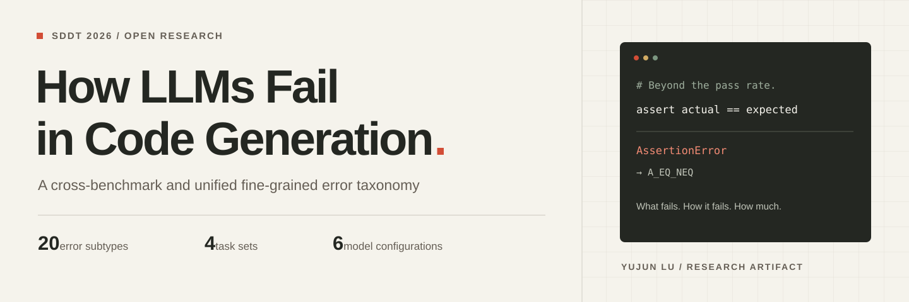

<div align="center">

[](https://yujun-lu.github.io/llm-codegen-error-taxonomy/)

# How LLMs Fail in Code Generation

### A Cross-Benchmark and Unified Fine-Grained Error Taxonomy

**Beyond pass rates: understand what fails, how it fails, and how much.**

[Project Website](https://yujun-lu.github.io/llm-codegen-error-taxonomy/) · [Paper](paper/paper.pdf) · [Taxonomy](docs/taxonomy.md) · [Reproducibility](docs/reproducibility.md) · [Citation](#citation)

**Yujun Lu** · Nanjing University of Information Science and Technology<br>
SDDT 2026 · [DOI: 10.1145/3838938.3838941](https://doi.org/10.1145/3838938.3838941)

**20 error subtypes · 4 task sets · 6 model configurations · 88 archived artifacts**

[](LICENSE)
[](https://doi.org/10.1145/3838938.3838941)
[](https://github.com/Yujun-Lu/llm-codegen-error-taxonomy/actions/workflows/checks.yml)

</div>

This repository accompanies the paper **How LLMs Fail in Code Generation: A Cross-Benchmark and Unified Fine-Grained Error Taxonomy**. It brings together the paper, a documented error taxonomy, retained evaluation artifacts, and scripts for inspecting and extending the analysis.

The study compares DeepSeek-V3.1, Kimi-K2, Qwen-Plus, and Qwen3-Coder-Plus, with additional thinking-mode runs for DeepSeek-V3.1 and Qwen-Plus. It examines HumanEval/HumanEval+, MBPP/MBPP+, and BigCodeBench Full/Hard through three complementary views:

| View | Question it answers |
| --- | --- |
| **Pass@1** | Does a generated solution pass every official test? |
| **Fine-grained error taxonomy** | Which failure semantics appear in the evaluator evidence? |
| **Macro / micro error ratios** | Among failed tasks, what proportion of official tests fail? |

## Findings from the paper

- **Semantic mismatches dominate.** Equality/inequality failures (`A_EQ_NEQ`) remain a central bottleneck across benchmarks and model configurations.
- **Thinking changes more than pass rates.** It can change failure severity even when the probability of a fully correct solution declines.
- **A shared taxonomy makes failures comparable.** Twenty subtypes connect `AssertionError` / `WrongAnswer`, `ValueError`, and `TypeError` across evaluators.

The taxonomy covers these three categories, not every possible Python failure. Model-generated labels are research annotations, not independently verified root causes. See the [taxonomy definitions and interpretation notes](docs/taxonomy.md).

## Quick start

Use **Python 3.10 or newer**. These commands require only the standard library; they make no API requests and do not execute archived model-generated code.

```bash
git clone https://github.com/Yujun-Lu/llm-codegen-error-taxonomy.git
cd llm-codegen-error-taxonomy
python scripts/verify_artifacts.py
python scripts/summarize_results.py --section paper
python scripts/summarize_results.py --format json --output outputs/summary.json
```

The verifier checks SHA-256 hashes and file sizes for **88 archived artifacts**, and parses **90 JSON/JSONL files**. The summary keeps published tables and archive-derived metrics in separate sections. No fresh evaluation is performed.

To inspect only the retained runs:

```bash
python scripts/summarize_results.py --section archive
```

## Paper-reported results

Pass@1 values below are transcribed from **Table 2 of the supplied paper**, at its displayed three-decimal precision. They are historical paper results, not measurements from a new run.

| Model | HumanEval | HumanEval+ | MBPP | MBPP+ | BCB Full | BCB Hard |
| --- | ---: | ---: | ---: | ---: | ---: | ---: |
| DeepSeek-V3.1 | 0.927 | 0.884 | 0.899 | 0.741 | 0.499 | **0.304** |
| DeepSeek-V3.1 (Thinking) | 0.951 | 0.902 | 0.963 | 0.810 | **0.504** | 0.284 |
| Kimi-K2 | 0.939 | 0.915 | 0.910 | 0.751 | 0.474 | 0.270 |
| Qwen-Plus | 0.970 | 0.927 | 0.937 | 0.802 | 0.468 | 0.277 |
| Qwen-Plus (Thinking) | **0.976** | **0.933** | **0.971** | **0.831** | 0.495 | 0.284 |
| Qwen3-Coder-Plus | 0.939 | 0.884 | 0.923 | 0.788 | 0.496 | 0.297 |

HumanEval and HumanEval+ use the same task set with different tests; the same is true of MBPP and MBPP+. BCB Hard is a subset of BCB Full. Bold marks the highest value in each column within this table.

The retained runs contain 164 HumanEval tasks, 378 MBPP tasks, 1,140 BCB Full tasks, and 148 BCB Hard tasks per configuration. All 36 pass@1 cells agree with the archived records at this display precision. The [reproduction guide](docs/reproducibility.md) documents retained coverage, model-name ambiguity, and missing classification labels.

[Machine-readable Tables 2 and 3](results/paper_tables.json) include provenance, metric definitions, and the paper's macro/micro error ratios. Both error ratios are conditional on **failed tasks**; neither is the overall task failure rate.

## What is released

| Material | Contents |
| --- | --- |
| [Paper](paper/paper.pdf) | The supplied nine-page conference paper |
| [Taxonomy](docs/taxonomy.md) | Definitions, examples, evaluator mapping, and labeling limits for all 20 subtypes |
| [EvalPlus artifacts](results/evalplus/) | HumanEval and MBPP evaluation records, reduced failure evidence, and classifications for all six configurations |
| [BigCodeBench artifacts](results/bigcodebench/) | Full and Hard evaluation records, stored pass@1 metrics, reduced failure evidence, and classifications for all six configurations |
| [LiveCodeBench supplement](results/livecodebench/) | Four `release_v6` generation files, each containing 1,055 question identifiers and generated-code records |
| [Scripts](scripts/) | Offline inspection, selected generation helpers, failure extraction, classification, and conversion tools |
| [Artifact manifest](results/manifest.json) | Original relative source locations, byte counts, and SHA-256 checksums |

This is a release of **retained research artifacts and analysis tools**. It does not contain a complete, locked environment or an end-to-end reproduction of every experiment. LiveCodeBench is supplemental material outside the paper's main tables; no LiveCodeBench evaluation score is inferred from its generation files. See [reproducibility and coverage](docs/reproducibility.md) for supported workflows and limitations.

```text
├── paper/                  Conference paper
├── docs/                   Research homepage, taxonomy, and reproduction guide
├── results/                Archived outputs, manifest, and paper tables
├── scripts/                Inspection and benchmark-specific research tools
├── tests/                  Offline regression tests
├── licenses/               Retained third-party license texts
├── CITATION.cff            Machine-readable citation metadata
└── THIRD_PARTY_NOTICES.md   License scope and artifact provenance
```

## Development

```bash
python -m unittest discover -s tests -v
python -m compileall -q scripts tests
```

The [checks workflow](.github/workflows/checks.yml) runs offline tests and artifact verification on Python 3.10–3.12. Optional generation and classification tools need additional dependencies and API credentials; see the [reproduction guide](docs/reproducibility.md). Contributions and artifact corrections are welcome through [issues](https://github.com/Yujun-Lu/llm-codegen-error-taxonomy/issues) and pull requests. Read [CONTRIBUTING.md](CONTRIBUTING.md) before changing research outputs.

## Citation

```bibtex
@inproceedings{lu2026llmsfail,
  author    = {Lu, Yujun},
  title     = {How {LLMs} Fail in Code Generation: A Cross-Benchmark and Unified Fine-Grained Error Taxonomy},
  booktitle = {The 2nd International Conference on Sustainable Development and Digital Transformation},
  series    = {SDDT 2026},
  year      = {2026},
  publisher = {ACM},
  doi       = {10.1145/3838938.3838941},
  url       = {https://doi.org/10.1145/3838938.3838941},
  numpages  = {9}
}
```

Full metadata is available in [CITATION.cff](CITATION.cff) and [BibTeX](docs/citation.bib).

## License and acknowledgments

Original project code and documentation are released under the [MIT License](LICENSE). The paper carries **CC BY 4.0**. Benchmark-derived content and reused upstream material retain their separate terms; see [THIRD_PARTY_NOTICES.md](THIRD_PARTY_NOTICES.md).

This research builds on EvalPlus, HumanEval, MBPP, BigCodeBench, and LiveCodeBench. Please credit the upstream benchmark authors as well as this work when using the corresponding materials.
